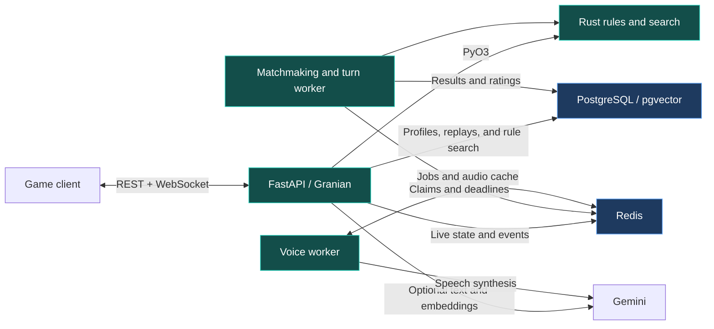

<div align="center">

<h1>DonkE Backend</h1>
<p><strong>Real-time multiplayer and AI coaching for Kazhutha, the Kerala card game.</strong></p>
<p>Python · FastAPI · Rust / PyO3 · Redis · PostgreSQL / pgvector · Gemini</p>
<p>
  <a href="#quick-start">Quick start</a> ·
  <a href="docs/api/README.md">API endpoint list</a> ·
  <a href="#architecture">Architecture</a> ·
  <a href="#showcase">WebSocket demo</a> ·
  <a href="docs/AI_EVAL.md">AI scorecard</a>
</p>

</div>

## What you can do

| Feature | What the backend provides |
| --- | --- |
| **Practice** | Play with one to four bots, choose a difficulty, and request a hint that scores your legal moves. |
| **Online matches** | Create private rooms or queue for classic and ranked matches. Reconnect to recover missed moves, and review finished matches through participant-only replays. |
| **Friends and progression** | Invite friends, queue as a party, earn coins and season rewards, and unlock cosmetics. |
| **Coaching and voice** | Ask the rules coach for cited answers in six languages, review decisions after a match, and request spoken commentary with Gemini text-to-speech. |
| **Operator console** | Review players, matches, reports, and fair-play cases. Manage seasons, feature flags, and the store from `/admin/`. |

## Quick start

### Practice API

Use CPython 3.14, Rust, and uv. Practice runs in memory and needs no external services or API keys.

```sh
uv sync --locked
uv run granian --interface asgi --host 127.0.0.1 --port 8000 app.main:app
```

Create a four-seat game and inspect `view.legal_moves` in the response.

```sh
curl --fail-with-body http://127.0.0.1:8000/api/v1/practice \
  -H 'Content-Type: application/json' \
  -d '{"seats": 4}'
```

Send the returned `access_token` as a Bearer token to read the game, request a hint, or play. To play, use a legal card, `view.version` as `expected_version`, and a new UUID as `request_id`. An identical retry returns the recorded response. See the [practice endpoints](docs/api/README.md#practice).

Run practice with one server worker. Sessions expire after an hour by default and reset on restart. For runtime-only installs, use `uv pip install -r requirements.txt` with the environment active. The file comes from `uv.lock` and includes the local PyO3 package.

### Online stack with rootless Podman

Install Podman and `podman-compose` inside WSL. Use [`.env.example`](.env.example) to configure `.env.dev` (preferred by the launcher) or `.env`.

| Variable | When to set it |
| --- | --- |
| `DONKE_POSTGRES_PASSWORD` | Required by Compose. Use a URL-safe random value. |
| `DONKE_AUTH_SECRET` | Required for the online stack. Use a separate random value of at least 32 bytes. |
| `DONKE_OBJECTS_ACCESS_KEY`, `DONKE_OBJECTS_SECRET_KEY` | Required by Compose. Credentials for the local S3-compatible media store. Use a long random secret. |
| `DONKE_GOOGLE_CLIENT_ID` | Enables player sign-in with Google. |
| `DONKE_GEMINI_API_KEY` | Enables Gemini calls for coaching, commentary, embeddings, and voice. |
| `DONKE_AI_PROVIDER` | AI backend from the registry in [`registry.py`](app/modules/ai/providers/registry.py): `gemini` (default) or `none`. |
| `DONKE_STORAGE_PROVIDER` | Object storage backend from the registry in [`storage.py`](app/core/storage.py): `s3` (default, any S3-compatible store) or `none`. |
| `DONKE_DEMO_MODE` | Set to `true` on a dedicated demo database to enable the showcase seed. |

```sh
bash scripts/podman-dev.sh config
bash scripts/podman-dev.sh up
curl --fail http://127.0.0.1:8000/ready
```

The launcher builds the image, waits for PostgreSQL and Redis, runs the Alembic baseline, prepares the season media bucket, then starts the API and background workers. PostgreSQL and Redis stay on the internal network. The media store ([RustFS](https://github.com/rustfs/rustfs), S3-compatible) listens on `127.0.0.1:9000` so the browser can load signed media URLs. Compose points the backend at it by default. To use a hosted bucket instead, set the `DONKE_SEASON_MEDIA_*` values and AWS credentials. Use `bash scripts/podman-dev.sh down` to stop the stack and retain its data volumes.

[Podman Compose documentation](https://docs.podman.io/en/latest/markdown/podman-compose.1.html)

<details>
<summary>Connect a device on your LAN from WSL</summary>

The online API listens on port `8000` on all WSL interfaces. Use the Windows host's LAN IP from another device, for example `http://192.168.1.10:8000`. Allow inbound TCP port `8000` in Windows Firewall. WSL2 NAT may also need port forwarding or mirrored networking. Keep the development port on your local network.

</details>

<details>
<summary>Use an existing PostgreSQL and Redis setup</summary>

Set `DONKE_POSTGRES_DSN`, `DONKE_REDIS_DSN`, and `DONKE_AUTH_SECRET` in `.env`. Run `uv run --locked alembic upgrade head`, start Granian as shown above, and run `uv run python -m app.workers.matchmaking` in a separate terminal. See the [online setup guide](docs/ONLINE_FOUNDATION.md) for identity, admin accounts, and storage requirements.

</details>

The baseline creates the full schema and enables pgvector on an empty development database. Repeated upgrades preserve data after the baseline is applied. See the [database setup guide](docs/ONLINE_FOUNDATION.md#database-setup) if your development database already contains DonkE tables.

## API reference

| Reference | What you get |
| --- | --- |
| **[Endpoint list](docs/api/README.md)** | Every documented HTTP operation grouped by feature, plus the gameplay socket and its messages. |
| [Swagger UI](http://127.0.0.1:8000/docs) · [ReDoc](http://127.0.0.1:8000/redoc) | Interactive requests and a browsable schema while the API server is running. |
| [OpenAPI JSON](docs/api/openapi.json) | Version-controlled HTTP contract with request, response, and authentication schemas. |
| [AsyncAPI JSON](docs/api/asyncapi.json) | Gameplay WebSocket contract with command, acknowledgment, event, and reconnect schemas. |

The gameplay socket is `WS /api/v1/games/{game_id}/ws`. Use a single-use ticket in a browser or a player Bearer header in a native client. Reconnect with `?after_sequence=<last_applied_sequence>` to replay missed public events and get a private snapshot for the player's seat. [Multiplayer protocol](docs/MULTIPLAYER.md)

## Architecture

[Backend module layout and FastAPI dependency audit](docs/BACKEND_ARCHITECTURE.md)



- **Real-time state.** One Redis Lua commit checks the game version and stores the move, acknowledgment, event batch, and next deadline together. Redis Streams let clients fetch events after a known sequence, and sorted sets let workers fetch due turns without scanning active matches.
- **Game worker.** Independent polls handle matchmaking, room starts, turns and settlement. `/api/v1/online/health` reports heartbeat age and due turn lag. [Worker and storage design](docs/BACKEND_ARCHITECTURE.md#low-level-design)
- **Durable history.** PostgreSQL settles completed games, rankings, and rewards transactionally. A composite index on `(player_id, finished_at DESC)` supports recent player history and head-to-head lookups over match participants.
- **Bots and coaching.** Rust runs rules and Monte Carlo move scoring. Post-match coaching replays decisions through the engine. The rules coach blends BM25 with pgvector retrieval when embeddings are configured and cites curated answers. Text and voice requests run outside the turn protocol.

<details>
<summary>Query performance on 20,000 synthetic matches</summary>

| PostgreSQL query | Replay JSONB scan | Indexed participant lookup |
| --- | ---: | ---: |
| Head-to-head, latest 200 shared matches | 76.7 ms | 2.04 ms |
| Admin history, latest 10 matches | 73.5 ms | 0.053 ms |

Values are median database execution times from 20 warm runs per query on local PostgreSQL 18.7. The before and after queries returned the same ordered match IDs. [Participant index](app/modules/matches/models/match_player.py)

</details>

## Showcase

With `DONKE_DEMO_MODE=true` on a dedicated demo database, start the online stack and run:

```sh
bash scripts/podman-dev.sh smoke
```

The demo seeds two players, plays a real WebSocket match, retries the opening move, reconnects a player who missed an event, and verifies the committed replay. [Showcase walkthrough](docs/SHOWCASE.md)

## Verification

| Offline fixture group | Passing |
| --- | ---: |
| Rule source selection and abstention | 12 / 12 |
| Commentary facts across six languages | 6 / 6 |
| Native game completion and 52-card conservation | 16 / 16 |

[Evaluation fixtures and results](docs/AI_EVAL.md) · [CI workflow](.github/workflows/ci.yml)

<details>
<summary>Run verification locally</summary>

```sh
cargo test --locked --manifest-path engine/Cargo.toml
cargo clippy --locked --workspace --all-targets --manifest-path engine/Cargo.toml -- -D warnings
uv run ruff check .
uv run pyright
uv run python -m scripts.export_openapi --check
uv run python -m scripts.export_asyncapi --check
uv run python -m scripts.evaluate --check
uv run pytest -q
```

Initialize a disposable PostgreSQL database with `uv run --locked alembic upgrade head`, then point `TEST_POSTGRES_DSN` and `TEST_REDIS_DSN` at the test stores. CI verifies the migration round trip, schema drift, and the Podman smoke flow.

</details>

## Product and operations guides

[Game and seasons](docs/GAME.md) · [AI and evaluation](docs/AI.md) · [Mobile web app](docs/APP.md) · [Admin operations](docs/ADMIN.md)

## Engineering notes

[Online setup](docs/ONLINE_FOUNDATION.md) · [Multiplayer protocol](docs/MULTIPLAYER.md) · [Season release walkthrough](docs/SEASON_RELEASE.md)

`dev-deploy` is the integration branch.
