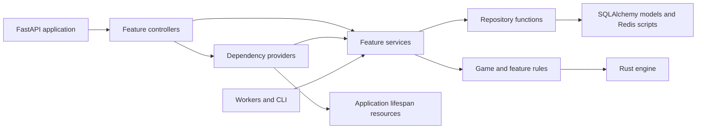

# Backend module architecture

DonkE is a modular FastAPI application with separate matchmaking and background worker processes. The API composes feature routers in `app/main.py`. Each feature keeps its HTTP and WebSocket contracts, use cases, and storage code close together. The same services can run from workers and the CLI without constructing a FastAPI request.

## File ownership

- `router.py` registers a feature's routes. Use `controllers/` when the feature has several distinct groups. Controllers handle transport concerns such as status codes, validation, headers, route-level authorization, and WebSocket messages.
- `dependencies.py` exposes typed FastAPI providers. Routers import providers directly. Domain functions and workers take ordinary Python arguments.
- `services/` groups use cases when the feature has multiple substantive services. A use case owns the order of reads, locks, writes, and external calls. A repository accepts the current session when its operation belongs to an existing transaction.
- `repositories/` separates materially different stores or groups of queries. Keep a single `repository.py` when one cohesive file is sufficient.
- `schemas.py` and protocol-specific schema files hold Pydantic contracts. `models.py` holds SQLAlchemy mappings. `app/core/schema.py` registers the mapped tables for readiness and Alembic, and `app/core/database.py` provides their shared declarative base. The schema registry depends on the platform resources to check readiness. Opening PostgreSQL and Redis is independent of model registration.
- Use names such as `calendar.py`, `rules.py`, and `selection.py` for policies and algorithms. Create a folder when there are multiple files with a clear shared purpose.

| Feature | Entry points and ownership |
| --- | --- |
| Admin | The auth router manages login, sessions, and TOTP. The console groups overview, player operations, account and flag management, and moderation. Audited mutations go through `admin_write`. [Console router](../app/modules/admin/console/router.py) · [Admin service](../app/modules/admin/service.py) |
| AI | Audio and commentary, coaching, and operator routes have separate controllers. The gateway manages provider access. Coaching, retrieval, and fair-play code have independent entry points. [AI router](../app/modules/ai/router.py) · [Gateway](../app/modules/ai/gateway.py) |
| Game | The practice controller serves guest practice and signed-in story attempts. `commands.py` shares move and retry validation. The in-memory practice repository owns admission, reservations, expiry, and token lookup. Story attempts use PostgreSQL and persist command receipts. Both paths build the same seeded duel from the shared story state. [Practice router](../app/modules/game/router.py) · [Story store](../app/modules/game/story_store.py) · [Repositories](../app/modules/game/repositories/) |
| Identity | The identity router owns Google sign-in, token refresh, and profile endpoints. Player authentication and write throttling are reusable dependencies. [Identity router](../app/modules/identity/router.py) · [Dependencies](../app/modules/identity/dependencies.py) |
| Lobby | Room and matchmaking routes share the lobby service. Redis Lua handles atomic transitions. Queue selection is an independent policy. [Lobby router](../app/modules/lobby/router.py) · [Selection](../app/modules/lobby/selection.py) |
| Multiplayer | HTTP history and WebSocket play have separate controllers. Socket schemas drive AsyncAPI export. Match startup and settlement orchestration live in the lifecycle service. Turn ownership, state versions, and acknowledgements are enforced through the match service and Redis Lua. [Multiplayer router](../app/modules/matches/router.py) · [Lifecycle](../app/modules/matches/services/lifecycle.py) |
| Progression | Store, season, reward, profile, and operator routes have separate controllers. Services separate purchases, season administration, player progress, rewards, and skill updates. Economy queries are shared by match and story settlement. [Progression router](../app/modules/progression/router.py) · [Services](../app/modules/progression/services/) · [Economy repository](../app/modules/progression/repositories/economy.py) |
| Social | Friends and blocks, parties, invitations, chat, and reports have separate controllers. Services take the lobby dependency when they need room or queue operations. Party queries are shared with season squads. [Social router](../app/modules/social/router.py) · [Services](../app/modules/social/services/) |
| Story | Campaign, collection, challenge links, result and awakening, and replay and coaching routes have separate controllers. Duel setup uses a service. Media and cue routes have their own HTTP contracts. [Story router](../app/modules/story/router.py) · [Duel service](../app/modules/story/services/duels.py) |

## FastAPI dependency audit

| Concern | Current pattern |
| --- | --- |
| Application resources | The lifespan opens the SQLAlchemy engine and session factory, Redis, and the AI gateway. The typed platform providers reuse these resources. `OptionalPlatform` supports guest practice and routes that can answer while online storage is offline. `PlatformDep` returns the existing 503 for routes that require online storage. [FastAPI lifespan](https://fastapi.tiangolo.com/advanced/events/) |
| Player identity | `OptionalPlayer` permits a guest request when bearer credentials are absent. Supplied credentials are authenticated, and `CurrentPlayer` additionally requires a principal. Player-write throttling depends on `CurrentPlayer`, so a protected endpoint and its throttle can reuse the same per-request result. [FastAPI sub-dependencies](https://fastapi.tiangolo.com/tutorial/dependencies/sub-dependencies/#using-the-same-dependency-multiple-times) |
| Admin identity | Console reads declare their staff role checks as route dependencies. Writes keep role and CSRF validation in `admin_write`, which records the audit entry in the same transaction as the mutation. The session cookie and headers retain their existing contracts. [FastAPI route dependencies](https://fastapi.tiangolo.com/tutorial/dependencies/dependencies-in-path-operation-decorators/) |
| SQLAlchemy sessions | Use cases create a short-lived session or transaction for their database work. Match settlement, purchases, reward claims, and audited writes commit before the operation reports that its changes were applied. Each concurrent task opens its own session. A `yield` provider is an option for request-local cleanup when the resource lifetime calls for it. [FastAPI yield scopes](https://fastapi.tiangolo.com/tutorial/dependencies/dependencies-with-yield/#early-exit-and-scope) · [SQLAlchemy concurrent tasks](https://docs.sqlalchemy.org/en/20/orm/extensions/asyncio.html#using-asyncsession-with-concurrent-tasks) |
| WebSocket identity | The socket controller resolves browser tickets and bearer authentication when the connection is opened. It preserves close-code handling and checks session validity as the connection runs. Database operations use short-lived sessions across these checks and commands. [FastAPI WebSockets](https://fastapi.tiangolo.com/advanced/websockets/#using-depends-and-others) |

The import-graph test rejects direct and transitive cycles between application modules. Run the OpenAPI and AsyncAPI export checks when moving an endpoint or changing a schema. Domain imports point toward the model, repository, or service that owns the operation. [Import-graph test](../tests/test_module_architecture.py) · [OpenAPI](api/openapi.json) · [AsyncAPI](api/asyncapi.json) · [FastAPI router composition](https://fastapi.tiangolo.com/tutorial/bigger-applications/)
