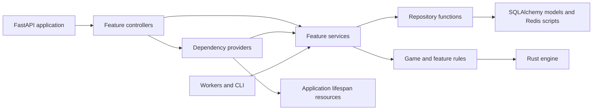

# Backend module architecture

DonkE is a modular FastAPI application with separate matchmaking and background worker processes. The API composes feature routers in `app/main.py`. Each feature keeps its HTTP and WebSocket contracts, use cases, and storage code close together. The same services can run from workers and the CLI without constructing a FastAPI request.

## File ownership

Every feature in `app/modules/` is split into packages by responsibility. A feature has only the packages it needs.

| Package | What goes in it |
| --- | --- |
| `controllers/` | HTTP and WebSocket handlers for a feature with several route groups: status codes, validation, headers, route-level authorization and socket messages. |
| `services/` | Use cases. A service owns the order of reads, locks, writes and external calls. |
| `repositories/` | PostgreSQL queries, Redis operations and the Lua scripts they load. A repository accepts the current session when its operation belongs to an existing transaction. |
| `models/` | SQLAlchemy mappings, one class per file. |
| `schemas/` | Pydantic contracts and the type aliases they expose, grouped by topic. |
| `dto/` | Dataclasses passed between layers. |
| `helpers/` | Rules, algorithms, constants and formatting with no database or network access, such as `calendar.py`, `rules.py` and `selection.py`. |
| `providers/` | In `ai` only: the AI backend interface, its registry and the implementations. |

`router.py` registers a feature's routes, and `dependencies.py` exposes typed FastAPI providers. Entry points run with `python -m`, such as `ai/mcp_server.py`, stay at the feature root.

Dependencies point downward: controllers use services, services use repositories, and all of them may use `models`, `schemas`, `dto` and `helpers`. Those four never import services, repositories or controllers. Package `__init__.py` files stay empty and imports name the file that defines the symbol, for example `from app.modules.identity.models.player import Player`. The import-graph test treats each module as depending on its parent package, so a re-export in `__init__.py` would be a cycle.

`app/core/schema.py` imports every model file to register its table for readiness and Alembic, so add new models there. `app/core/database.py` provides their shared declarative base.

| Feature | Entry points and ownership |
| --- | --- |
| Admin | The auth router manages login, sessions, and TOTP. The console groups overview, player operations, account and flag management, and moderation. Audited mutations go through `admin_write`. [Console router](../app/modules/admin/controllers/console/router.py) · [Admin service](../app/modules/admin/services/admin.py) |
| AI | Audio and commentary, coaching, and operator routes have separate controllers. The gateway manages provider access. Coaching, retrieval, and fair-play code have independent entry points. [AI router](../app/modules/ai/router.py) · [Gateway](../app/modules/ai/services/gateway.py) |
| Game | The practice controller serves guest practice and signed-in story attempts. `helpers/commands.py` shares move and retry validation. The in-memory practice repository owns admission, reservations, expiry, and token lookup. Story attempts use PostgreSQL and persist command receipts. Both paths build the same seeded duel from the shared story state. [Practice router](../app/modules/game/router.py) · [Story store](../app/modules/game/services/story_store.py) · [Repositories](../app/modules/game/repositories/) |
| Identity | The identity router owns Google sign-in, token refresh, and profile endpoints. Player authentication and write throttling are reusable dependencies. [Identity router](../app/modules/identity/router.py) · [Dependencies](../app/modules/identity/dependencies.py) |
| Lobby | Room and matchmaking routes share the lobby service. Redis Lua handles atomic transitions. Queue selection is an independent policy. [Lobby router](../app/modules/lobby/router.py) · [Selection](../app/modules/lobby/helpers/selection.py) |
| Multiplayer | HTTP history and WebSocket play have separate controllers. Socket schemas drive AsyncAPI export. Match startup and settlement orchestration live in the lifecycle service. Turn ownership, state versions, and acknowledgements are enforced through the match service and Redis Lua. [Multiplayer router](../app/modules/matches/router.py) · [Lifecycle](../app/modules/matches/services/lifecycle.py) |
| Progression | Store, season, reward, profile, and operator routes have separate controllers. Services separate purchases, season administration, player progress, rewards, and skill updates. Economy queries are shared by match and story settlement. [Progression router](../app/modules/progression/router.py) · [Services](../app/modules/progression/services/) · [Economy repository](../app/modules/progression/repositories/economy.py) |
| Social | Friends and blocks, parties, invitations, chat, and reports have separate controllers. Services take the lobby dependency when they need room or queue operations. Party queries are shared with season squads. [Social router](../app/modules/social/router.py) · [Services](../app/modules/social/services/) |
| Story | Campaign, collection, challenge links, result and awakening, and replay and coaching routes have separate controllers. Duel setup uses a service. Media and cue routes have their own HTTP contracts. [Story router](../app/modules/story/router.py) · [Duel service](../app/modules/story/services/duels.py) |

## FastAPI dependency audit

| Concern | Current pattern |
| --- | --- |
| Application resources | The lifespan opens the SQLAlchemy engine and session factory, Redis, and the AI gateway. The typed platform providers reuse these resources. `OptionalPlatform` supports guest practice and routes that can answer while online storage is offline. `PlatformDep` returns the existing 503 for routes that require online storage. [FastAPI lifespan](https://fastapi.tiangolo.com/advanced/events/) |
| Player identity | `OptionalPlayer` permits a guest request when bearer credentials are absent. Supplied credentials are authenticated, and `CurrentPlayer` additionally requires a principal. Player-write throttling depends on `CurrentPlayer`, so a protected endpoint and its throttle can reuse the same per-request result. [FastAPI sub-dependencies](https://fastapi.tiangolo.com/tutorial/dependencies/sub-dependencies/#using-the-same-dependency-multiple-times) |
| Admin identity | Console reads declare their staff role checks as route dependencies. Writes keep role and CSRF validation in `admin_write`, which records the audit entry in the same transaction as the mutation. The session cookie and headers retain their existing contracts. [FastAPI route dependencies](https://fastapi.tiangolo.com/tutorial/dependencies/dependencies-in-path-operation-decorators/) |
| SQLAlchemy sessions | Use cases create a short-lived session or transaction for their database work. Match settlement, purchases, reward claims, and audited writes commit before the operation reports that its changes were applied. Each concurrent task opens its own session. A `yield` provider is an option for request-local cleanup when the resource lifetime calls for it. [FastAPI yield scopes](https://fastapi.tiangolo.com/tutorial/dependencies/dependencies-with-yield/#early-exit-and-scope) · [SQLAlchemy concurrent tasks](https://docs.sqlalchemy.org/en/20/orm/extensions/asyncio.html#using-asyncsession-with-concurrent-tasks) |
| WebSocket identity | The socket controller resolves browser tickets and bearer authentication when the connection is opened. It preserves close-code handling and checks session validity as the connection runs. Database operations use short-lived sessions across these checks and commands. [FastAPI WebSockets](https://fastapi.tiangolo.com/advanced/websockets/#using-depends-and-others) |

The import-graph test rejects direct and transitive cycles between application modules. Run the OpenAPI and AsyncAPI export checks when moving an endpoint or changing a schema. Domain imports point toward the model, repository, or service that owns the operation. [Import-graph test](../tests/test_module_architecture.py) · [OpenAPI](api/openapi.json) · [AsyncAPI](api/asyncapi.json) · [FastAPI router composition](https://fastapi.tiangolo.com/tutorial/bigger-applications/)

## Low-level design

| Flow | Implementation and invariant |
| --- | --- |
| Practice | The in-process repository reserves capacity before dealing and validates token digests and expiry. When the table is full, finished matches are dropped (plain practice first, oldest first) before a new match is refused. A match lock serializes plays. An identical request UUID and payload return the recorded result. A new play replaces the prior engine snapshot after native validation. |
| Seat admission | `app/modules/lobby/repositories/lobby.py` and its Lua script fence claims and check player membership. A room starts only if its ready revision and all seat reservations match. |
| Player move | `app/modules/matches/controllers/socket.py` authenticates the socket. `MatchService` restores the native game, applies a legal move and asks `game.lua` to commit. The script checks connection ownership and version, then publishes the snapshot, stream batch, receipt and next deadline atomically. Retried request IDs return the original acknowledgement when the payload matches. |
| Reconnect | The browser exchanges its access token for a same-origin, single-use socket ticket. Native clients can send a Bearer header. The API replays public batches after the last applied sequence and sends a private seat view. A newer connection supersedes the previous one. |
| Game worker | `app/workers/matchmaking.py` runs independent polls for matching, room starts, turns and settlement. The turn poll tracks up to four in-flight games and refills free slots. Rust search runs in a thread so the event loop can renew leases and advance other tables. |
| Turn lease | A Redis lease grants two seconds of ownership and is refreshed every half second while the turn runs. Lua checks the owner before renewal, release, or retry deferral. The final commit also checks the version and deadline. A crashed worker leaves the turn due for another worker after the lease expires. |
| Settlement | A terminal Lua commit adds a pending settlement. `app/modules/matches/services/settlement.py` inserts a result once and applies rating and progression in the same SQL transaction. A retry after a lost response can enqueue fair-play work without reapplying SQL effects. Redis removes the pending entry and releases room reservations after settlement succeeds. |
| Swappable providers | AI and object storage sit behind interfaces: `AIProvider` in [`providers/base.py`](../app/modules/ai/providers/base.py) and `ObjectStore` in [`storage.py`](../app/core/storage.py). `DONKE_AI_PROVIDER` and `DONKE_STORAGE_PROVIDER` pick an implementation from a registry. The gateway receives the AI provider and `Platform.storage` carries the store, so features never name a vendor. `create_app(ai=..., storage=...)` and `open_platform(settings, storage)` accept overrides for tests. Model ids come from the provider, so caches and stored embeddings never mix models. To add a backend, implement the interface and call `register_provider` or `register_storage`. |
| Fair-play queue | Each Taskiq drain atomically claims due ranked matches and moves their retry scores forward by the claim lease. Later due entries become visible to the next drain. A failed dispatch stays queued for retry after the lease. Successful analysis removes the queue entry. |
| Runtime flags | PostgreSQL stores overrides. After commit, the admin path increments the Redis generation and deletes the cached hash in one transaction. A slow cache fill can publish only against the generation it read before SQL. If invalidation fails while Redis is unavailable, a cached snapshot can survive until its 30-second TTL. |
| Health | `/healthz` checks the API process and `/ready` checks configured storage and schema. `/api/v1/online/health` also requires a turn scheduler heartbeat less than 10 seconds old. The response includes the oldest currently due turn lag, which can reveal a backlog even while the scheduler responds. |

Online rooms, active matches and pending settlements depend on Redis persistence and its no-eviction policy. PostgreSQL retains settled history after Redis data loss. Taskiq analysis uses retryable delivery and a five-minute lease, so a job that exceeds the lease may be delivered again. [Online storage guide](ONLINE_FOUNDATION.md) · [Multiplayer guide](MULTIPLAYER.md)
