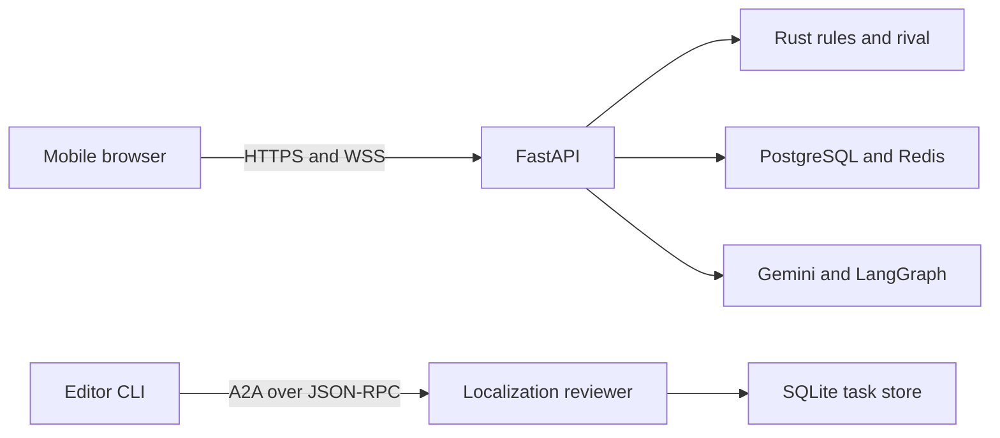

# DonkE mobile release and interview demo

The mobile website uses React, TypeScript, Vite and Three.js. FastAPI owns the API. Rust resolves cards and scores the rival. PostgreSQL stores player progression and authored cues. Redis supports online matches, jobs and audio. The optional A2A reviewer checks draft dialogue in a separate process and keeps its tasks in a separate SQLite file.



## Walkthrough

1. Open Home on a phone. Start a story duel and call a Strike when offered. Finish the hand and open the rival evidence. Ask “What is a Strike?” for the curated rule citation. The seeded demo runs with the Gemini provider unavailable.
2. Share the finished duel and open the link in a fresh browser. Play the same opening and compare outcomes. Watch the built-in sample match to jump directly to a Strike.
3. Sign in, choose a character and expand **Explain final-form unlock**. Check that the character objective changes to Complete and the claim control follows the server's eligibility.
4. Generate an offline trace and verify the scorecard. The trace contains a synthetic duel's public outcome and the scored rival decision. The checked-in scorecard covers citation and abstention fixtures, localized commentary, card conservation, awakening and the two fallback caption locales. [Scorecard](AI_EVAL.md)

```sh
uv run --locked python -m scripts.evaluate --trace
uv run --locked python -m scripts.evaluate --check
```

## Mobile build and deployment

Run `bun install --frozen-lockfile`, `bun test` and `bun run build` in the frontend. Serve the built website and its model and replay assets. Forward `/api/v1` on the same origin and preserve WebSocket upgrades. Configure the Google web client ID for sign-in. Provision a 21-day pack through the backend admin API. [Season setup](SEASONAL_BACKEND_MIGRATION.md)

The production build keeps the roughly 239 kB gzipped renderer in a shared lazy chunk. Mobile Chromium verification opens the sample replay and requests a hero preview with reduced motion enabled, with zero 3D JavaScript or GLB requests. Switching the preference back restores the 3D table. With motion enabled, requesting the hero preview downloads the selected GLB in one GET. Physical-device frame timing, audio latency and the hosted end-to-end walkthrough still need a device and deployment. [React Three Fiber rendering guidance](https://r3f.docs.pmnd.rs/advanced/scaling-performance)

## Standalone localization reviewer

This reviewer uses the official A2A SDK v1 and exposes its agent card at `/.well-known/agent-card.json` and JSON-RPC at `/a2a`. It accepts one to eight English and Japanese cue pairs. It returns language and caption-policy findings and flags the legacy English term “Vettu”. A ready report moves the pair to human translation and performance review. The admin publishing flow still validates and publishes the final pair. The reviewer does not require PostgreSQL, Redis, Gemini access or player data. [A2A specification](https://a2a-protocol.org/v1.0.0/specification/) · [Official Python SDK](https://github.com/a2aproject/a2a-python)

Set `DONKE_REVIEW_TOKEN` to a shared secret of at least 32 characters in both shells. Set `DONKE_REVIEW_DATABASE` to an absolute path on persistent storage for the reviewer. The default agent origin is `http://127.0.0.1:8011`. For a remote deployment, configure `DONKE_REVIEW_ORIGIN` to the service's HTTPS origin.

```sh
uv run --locked --extra a2a granian --interface asgi --host 127.0.0.1 --port 8011 --factory app.services.localization_review:create_app
```

Save a cue batch as `cues.json`.

```json
{
  "lines": [
    {
      "character": "Ashblade",
      "moment": "victory",
      "en": "I made it through. Until next time.",
      "ja": "切り抜けたぞ。また会おう。"
    }
  ]
}
```

```sh
uv run --locked --extra a2a python -m scripts.review_cues --batch cues.json
uv run --locked --extra a2a python -m scripts.review_cues --task TASK_ID
```

The client discovers the card and checks the RPC endpoint before sending credentials. The response contains a task ID and findings. SQLite keeps the task status and findings without the submitted dialogue. After restarting the reviewer, use the same SQLite file and token and retrieve the result with the task ID. Resubmit a revised batch as a new task and use the existing admin review to publish.
