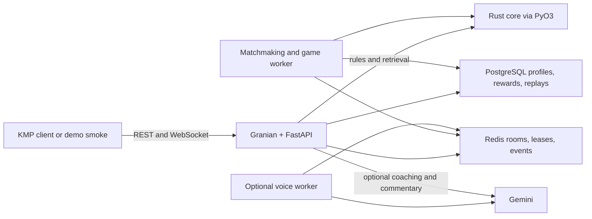

# DonkE showcase

A two-player demo exercises the same API and worker as an online match. It opens with the Ace of Spades, retries the opening command, resumes the other player's socket after the missed move, then plays to a committed replay.

## Start the Podman stack

Inside WSL, install rootless Podman and `podman-compose`. Configure the database password and auth secret from [the setup guide](../README.md). Use a dedicated demo database and set `DONKE_DEMO_MODE=true` before starting the stack.

```sh
uv sync --locked
bash scripts/podman-dev.sh up
bash scripts/podman-dev.sh smoke
```

The script selects the Podman Compose provider even when another provider is present. It starts PostgreSQL and Redis, runs the migration to completion, and starts Granian and the workers. Podman pulls base images by their explicit registry names. The smoke command writes short-lived player tokens to Linux temporary files and removes those files when it exits. Demo seeding is an operator CLI guarded by `DONKE_DEMO_MODE`. No alternate player-login route is added.

Run `bash scripts/podman-dev.sh ps` or `bash scripts/podman-dev.sh logs` to inspect the stack. The `down` command preserves database volumes.

## Run the demo with local services

With a dedicated local PostgreSQL database and Redis, use the [online foundation settings](ONLINE_FOUNDATION.md). Migrate, then start the API and matchmaking worker. Keep `DONKE_DEMO_MODE=true` in the seed command's environment.

```sh
sessions_dir="$(mktemp -d)"
export DONKE_DEMO_MODE=true
uv run python -m scripts.seed_demo --sessions "$sessions_dir/demo-sessions.json"
uv run python -m scripts.demo_smoke --sessions "$sessions_dir/demo-sessions.json"
rm -- "$sessions_dir/demo-sessions.json"
rmdir -- "$sessions_dir"
```

Seeding creates two recognizable profiles, an accepted friendship, six deterministic archived games, and earned-coin balances. It creates a sample season if the seasons table is empty. Reruns reuse the profiles and archive IDs and leave credited rewards unchanged. Live demo games create their own room and match IDs.

## Architecture



A move and its acknowledgements, events, and next deadline share one Redis commit. A worker settles the finished game once in PostgreSQL. The stream and private snapshots support reconnect, and the participant-only replay is read from PostgreSQL after settlement. If Redis loses a live match state, the next lobby access releases that room's seat reservations so players can requeue. Readiness checks that PostgreSQL has the expected migration head and that Redis is reachable.

## Release evidence

The [offline scorecard](AI_EVAL.md) covers rule lookup and abstention, Vettu facts in six locales, and native game completion across seat counts. The [OpenAPI](api/openapi.json) and [AsyncAPI](api/asyncapi.json) exports document the client contracts. CI checks both exports, the scorecard, migrations, service tests and the Podman smoke workflow. Live Google sign-in and Gemini quality require credentials and a separate provider run.

[Podman Compose provider selection](https://docs.podman.io/en/latest/markdown/podman-compose.1.html)
