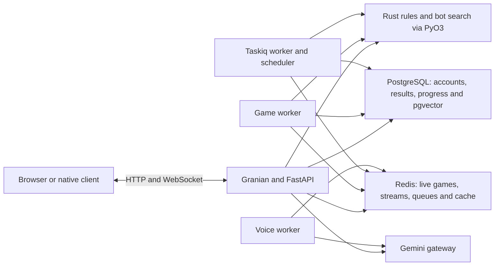

# DonkE backend design

This document describes the code in this repository and the boundaries between the API, game worker, background jobs and data stores. The browser and native clients share the HTTP and gameplay contracts. [HTTP and WebSocket reference](api/README.md)

## Kazhutha rules

- The no-trump rules used by DonkE match the core of the version documented by Cheettukali. A standard 52-card deck is dealt out, A♠ opens, and players follow the led suit when they can. A player void in that suit plays a **Vettu** (വെട്ട്), ending the trick immediately. The highest card of the led suit takes the entire pile and leads again. When everyone follows suit, the cards are discarded and the highest card leads. The last player with cards is the Kazhutha (കഴുത). [Cheettukali rules](https://cheettukali.com/kazhutha/rules/)
- DonkE supports 2–5 seats, advances through seats in clockwise order, and confirms escapes only after resolution. A player who emptied their hand during the trick can still receive a Vettu pile. The engine ranks escapes in play order and allows an `all_safe` finish. Cheettukali describes anticlockwise play and optional letter scoring across deals. Pagat records a Kasaragod version where the first off-suit card establishes trump. Keeping the current rules as the default gives any future house-rule mode a clear compatibility baseline. [Cheettukali rules](https://cheettukali.com/kazhutha/rules/) · [Pagat’s Kasaragod rules](https://www.pagat.com/inflation/getaway.html#donkey)

## High-level design

The Python backend is a modular monolith deployed as separate API and worker processes. The Rust engine owns the card rules and scoring. Python owns sessions, rooms, scheduling, progression, and API contracts. Redis supplies atomic live-state transitions and PostgreSQL owns durable records. Process separation lets an API restart preserve an online table while Redis and the game worker remain available.

| Module | Responsibility |
| --- | --- |
| `game` | Guest practice, local session state, move and hint endpoints. Practice state is held in API process memory. |
| `identity`, `social` | Google login, token rotation, player profiles, friends, blocks, chat and room invites. |
| `lobby` | Rooms, readiness, queue membership, match assembly, and abandoned-claim recovery. |
| `matches` | Game lifecycle, socket authentication, private views, ordered public events, worker deadlines and settlement. |
| `progression` | Rankings and hidden skill, wallet ledger, cosmetic inventory, seasons, rewards and achievements. |
| `ai`, `admin` | Optional coaching, narration and voice, fair-play review, audited moderation and runtime flags. |

## Low-level design

| Flow | Implementation and invariant |
| --- | --- |
| Seat admission | `app/modules/lobby/repository.py` and its Lua script fence claims and check player membership. A room starts only if its ready revision and all seat reservations match. |
| Player move | `app/modules/matches/router.py` authenticates the socket. `MatchService` restores the native game, applies a legal move and asks `game.lua` to commit. The script checks connection ownership and version, then publishes the snapshot, stream batch, receipt and next deadline atomically. Retried request IDs return the original acknowledgement when the payload matches. |
| Reconnect | The browser exchanges its access token for a same-origin, single-use socket ticket. Native clients can send a Bearer header. The API replays public batches after the last applied sequence and sends a private seat view. A newer connection supersedes the previous one. |
| Game worker | `app/workers/matchmaking.py` runs independent polls for matching, room starts, turns and settlement. The turn poll tracks up to four in-flight games and refills free slots. Rust search runs in a thread so the event loop can renew leases and advance other tables. |
| Turn lease | A Redis lease grants two seconds of ownership and is refreshed every half second while the turn runs. Lua checks the owner before renewal, release, or retry deferral. The final commit also checks the version and deadline. A crashed worker leaves the turn due for another worker after the lease expires. |
| Settlement | A terminal Lua commit adds a pending settlement. `app/modules/matches/settlement.py` inserts a result once and applies rating and progression in the same SQL transaction. A retry after a lost response can enqueue fair-play work without reapplying SQL effects. Redis removes the pending entry and releases room reservations after settlement succeeds. |
| Fair-play queue | Each Taskiq drain atomically claims due ranked matches and moves their retry scores forward by the claim lease. Later due entries become visible to the next drain. A failed dispatch stays queued for retry after the lease. Successful analysis removes the queue entry. |
| Runtime flags | PostgreSQL stores overrides. After commit, the admin path increments the Redis generation and deletes the cached hash in one transaction. A slow cache fill can publish only against the generation it read before SQL. If invalidation fails while Redis is unavailable, a cached snapshot can survive until its 30-second TTL. |
| Health | `/healthz` checks the API process and `/ready` checks configured storage and schema. `/api/v1/online/health` also requires a turn scheduler heartbeat less than 10 seconds old. The response includes the oldest currently due turn lag, which can reveal a backlog even while the scheduler responds. |

Online rooms, active matches and pending settlements depend on Redis persistence and its no-eviction policy. PostgreSQL retains settled history after Redis data loss. Taskiq analysis uses retryable delivery and a five-minute lease, so a job that exceeds the lease may be delivered again. [Online storage guide](ONLINE_FOUNDATION.md) · [Multiplayer guide](MULTIPLAYER.md)
