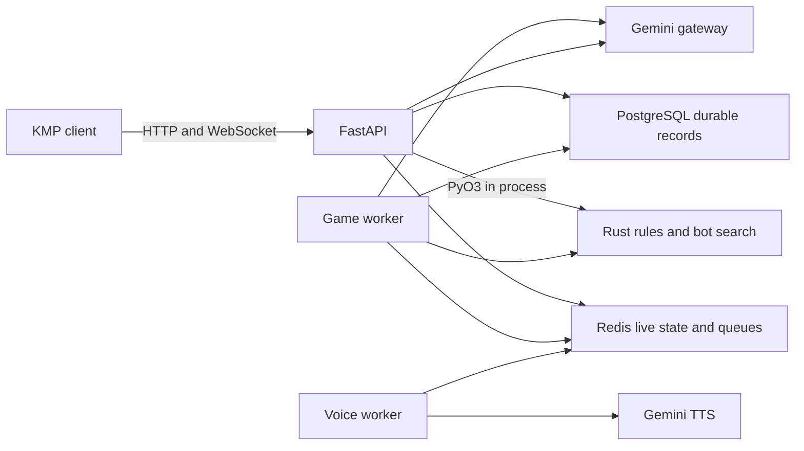

# DonkE backend study

The new backend is a from-scratch rewrite in `DonkE-Backend`. The separately located `donkey_backend` is the read-only implementation reference. The project briefs specify a premium, family-friendly Kazhutha game with earned-only cosmetics, fast tables, and optional localized AI. The rewrite follows the later brief for seasons and the admin panel.

## Kazhutha rules

- The no-trump rules used by DonkE match the core of the version documented by Cheettukali. A standard 52-card deck is dealt out, A♠ opens, and players follow the led suit when they can. A player void in that suit plays a **Vettu** (വെട്ട്), ending the trick immediately. The highest card of the led suit takes the entire pile and leads again. When everyone follows suit, the cards are discarded and the highest card leads. The last player with cards is the Kazhutha (കഴുത). [Cheettukali rules](https://cheettukali.com/kazhutha/rules/)
- DonkE supports 2–5 seats, advances through seats in clockwise order, and confirms escapes only after resolution. A player who emptied their hand during the trick can still receive a Vettu pile. The engine ranks escapes in play order and allows an `all_safe` finish. Cheettukali describes anticlockwise play and optional letter scoring across deals. Pagat records a Kasaragod version where the first off-suit card establishes trump. Keeping the current rules as the default gives any future house-rule mode a clear compatibility baseline. [Cheettukali rules](https://cheettukali.com/kazhutha/rules/) · [Pagat’s Kasaragod rules](https://www.pagat.com/inflation/getaway.html#donkey)

## High-level design

| Domain | Current implementation | Revamp design implication |
| --- | --- | --- |
| Identity | Google and Apple sign-in, rotating refresh sessions, Redis rate limits, moderation checks. | Group account and session ownership together. Keep existing session behavior through migration. |
| Live game | FastAPI and Redis orchestrate seats, matchmaking, pacing and recovery. Rust owns legal moves, cut and clean-trick outcomes, and bot search. | Split orchestration by lifecycle, turn and publication responsibilities while preserving the state format and command contract. |
| Social | Friends, blocks, invites, chat and party-aware matchmaking share the room and presence services. | Give social code a room and queue interface. Keep whole-party seating atomic. |
| Progression and store | Ranked MMR, hidden skill, peak-MMR seasons, daily missions, an idempotent coin ledger and cosmetic inventory. The current store also handles Play purchases. | The revamp’s free season track, weekly challenges and earned-only store require explicit rules for existing balances, entitlements and season history. |
| AI and voice | The gateway tracks Gemini usage and budgets. Coaching retrieves pgvector matches with a keyword fallback. Commentary and speech are optional delivery paths. The operator MCP server uses stdio. | Keep engine facts and validation at the boundary. Hybrid retrieval, voice selection and additional transports are revamp work. |
| Admin and operations | FastAPI serves an existing admin panel. Admin, economy and AI operator features share the app and its data stores. | Separate admin account and audit ownership in the target design. Keep route and migration changes outside gameplay cleanup. |

The reference repository's architecture documentation covers the deployed system. The reference OpenAPI and AsyncAPI exports describe the client contracts.

## Low-level design

| Flow | Implementation and invariants |
| --- | --- |
| Seat admission | RoomService (`app/service/room_service.py`) and PlayerGuard (`app/service/player_guard.py`) coordinate queue and room membership. MatchmakingService (`app/service/matchmaking_service.py`) uses Redis Lua to claim players, fence room creation, finalize a match, and recover or re-enqueue stale claims. A cancellation must survive a stale worker. |
| Play | WebSocket handlers (`app/routers/ws_handlers.py`) parse and dispatch a command. GameService (`app/service/game_service.py`) checks the seat and version and resolves retries by request ID. The Rust engine (`engine/src/game/rules.rs`) returns the next state and ordered events. A Redis transaction commits the version, events, command outcome and publication work together. |
| Publish and reconnect | The outbox retries from a sequence cursor. ConnectionManager (`app/service/connection_manager.py`) fans out through Redis, bounds socket queues and tracks ownership by session. Clients deduplicate public events by game and sequence and recover the caller's hand and legal moves with a private sync. Admission is automatic in the reference socket. Its advertised explicit `join` action lacks a handler. |
| Timers and exits | The timeout worker (`app/service/timeout_worker.py`) claims due jobs from a sorted set with renewable leases and owner-checked completion. Auto-play is version-fenced. Takeover keeps the seat's cards and separates the original player's penalties. The orphan reconciler (`app/service/orphan_reconciliation_service.py`) handles SQL games whose live state disappeared. |
| Settlement | A terminal Redis state schedules retryable SQL work. GameResultPersistenceService (`app/service/game_result_persistence.py`) applies the result, ranking and progression in one database transaction, with idempotency checks and post-commit notification recovery. Redis and SQL have separate commit boundaries. |
| Optional AI | VoiceWorker (`app/workers/voice_worker.py`) leases stream messages, honors budgets and a concurrency limit, caches audio, and dead-letters exhausted jobs. Coaching (`app/ai/coaching.py`) can return engine-derived tips when generation fails. Commentary can be omitted while the match continues. |
